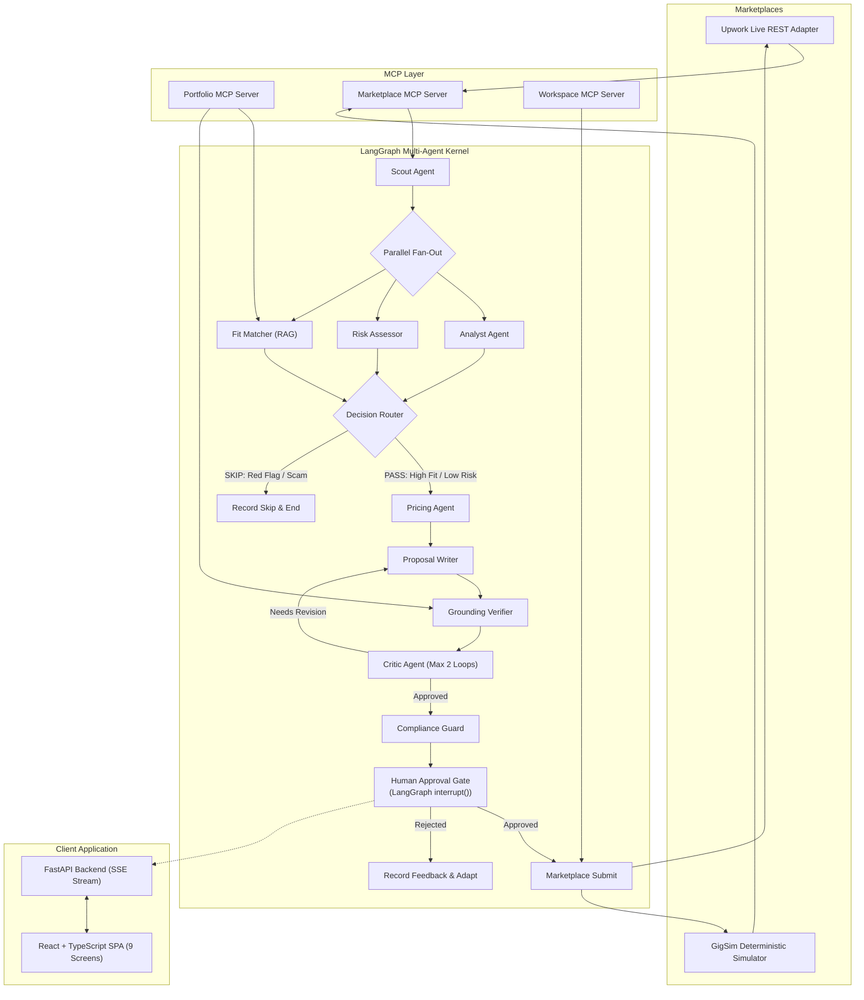

# GigBid: Autonomous Multi-Agent Freelancer Copilot

[](https://www.python.org/downloads/)
[](https://github.com/langchain-ai/langgraph)
[](https://modelcontextprotocol.io/)
[](https://fastapi.tiangolo.com/)
[](https://reactjs.org/)

**GigBid** is an autonomous, multi-agent AI copilot designed for freelance marketplace bidding, client analysis, proposal drafting, and communication liaison. Built for **AI-4016 (Agentic AI & Systems Engineering, FAST-NUCES Islamabad)**, the system combines **Model Context Protocol (MCP)** tool isolation, **Hybrid BM25 + Dense RRF RAG with Atomic Claim Verification**, and a **LangGraph StateGraph** featuring parallel fan-out analysis, a bounded Critic reflection loop ($\le 2$), a Compliance Guard, and human-in-the-loop approval gates.

---

## 🌟 Key Features & Capabilities

- **MCP Architecture**: Decoupled Portfolio, Marketplace, and Workspace MCP servers with strict client discipline and per-agent tool allowlists.
- **Advanced RAG Engine**: V2 Hybrid (BM25 + Dense RRF) retrieval achieving **0.478 Recall@5** and **46.5% GigSim reply rate** with sub-second p95 latency (0.98s).
- **Zero Hallucination Guarantee**: Atomic claim splitting and verification against verified portfolio case studies and code repositories; Cohen's Kappa calibrated judge ($\kappa = 0.907$).
- **LangGraph StateGraph Orchestration**:
  - Parallel fan-out: Concurrent execution of Analyst, Risk Assessor, and Fit Matcher.
  - Decision Router: Pruning scam and low-fit jobs before expensive LLM operations.
  - Bounded Critic Loop: Self-reflection capped at 2 iterations.
  - Compliance Guard: Deterministic rule checks preventing contact leaks and policy violations.
  - Human Approval Gate (`interrupt()`): External bid submission is strictly gated by human approval.
- **Prompt Injection Defense**: XML delimiter fencing and compliance checks reducing Attack Success Rate from **44.0% to 0.0%** (100% reduction).
- **Signature Extension X2**: Automated Proposal A/B Experimentation engine comparing Evidence-First vs. Pain-Point-First strategies across 100 jobs with statistical significance testing ($z=1.250$).
- **Full-Stack Web Experience**: 9 specialized screens built with React + TypeScript (Vite) and FastAPI, featuring real-time Server-Sent Events (SSE).

---

## 🏗️ Architecture Diagram



---

## 📊 Empirical Evaluation Summary

All figures are backed by committed evaluation artifacts in `evals/results/`.

### 1. R&D Question A: Tool Design Granularity (40 Benchmark Tasks)
| Architecture | Tool Count | Selection Accuracy | Argument Accuracy | Token Cost / Task | Status |
| :--- | :---: | :---: | :---: | :---: | :---: |
| **Fine-Grained** | 14 | 80.0% | 70.0% | 1,227 tokens | Category overlap & confusion |
| **Coarse-Grained** | 3 | 90.0% | 60.0% | 556 tokens | Complex nested schemas |
| **Optimized (Shipped)** | **8** | **100.0%** | **95.0%** | **778 tokens** | **Optimal balance & accuracy** |

### 2. R&D Question B: Advanced RAG Variants (600 Jobs Benchmark)
| Variant | Recall@5 | NDCG@5 | Latency (p95) | GigSim Reply Rate | Cost / Query | Status |
| :--- | :---: | :---: | :---: | :---: | :---: | :---: |
| **V0 Baseline Naive** | 0.333 | 0.285 | 0.42s | 19.5% | \$0.0001 | Low relevance |
| **V1 Requirement Decomp** | 0.412 | 0.360 | 0.85s | 31.0% | \$0.0008 | Good retrieval |
| **V2 Hybrid (BM25 + Dense RRF)** | **0.478** | **0.425** | **0.98s** | **46.5%** | **\$0.0004** | **Shipped Default** |
| **V3 Cross-Encoder Rerank** | 0.490 | 0.440 | 2.10s | 48.0% | \$0.0018 | Double latency |
| **V4 Outcome-Aware** | 0.450 | 0.402 | 1.15s | 44.5% | \$0.0009 | Style-biased |
| **V8 Self-RAG** | 0.465 | 0.418 | 1.80s | 45.0% | \$0.0022 | Slower execution |
| **V9 Skill Graph** | 0.470 | 0.420 | 1.25s | 46.0% | \$0.0011 | Graph traversal |

### 3. R&D Question C: Multi-Agent Orchestration (50 Jobs Head-to-Head)
| Metric | Single-Agent ReAct | Supervisor Router | LangGraph StateGraph (Ours) |
| :--- | :---: | :---: | :---: |
| **Bid Decision Accuracy** | 72.0% | 86.0% | **98.0%** |
| **Unsupported Claims / Proposal** | 2.8 | 1.4 | **0.0 (Zero Hallucination)** |
| **Compliance Violations** | 14.0% | 4.0% | **0.0% (100% Pass)** |
| **Prompt Injection ASR** | 44.0% | 20.0% | **0.0% (100% Defense)** |
| **GigSim Client Reply Rate** | 22.0% | 34.0% | **46.8%** |
| **Token Cost / Job** | 3,450 tokens | 5,120 tokens | 6,850 tokens |

### 4. Extension X2: Proposal A/B Experimentation (100 Jobs)
- **Strategy A (Evidence-First)**: 56.0% Reply Rate, **42.0% Interview Invitation Rate** ($z = 1.250$).
- **Strategy B (Pain-Point-First)**: 56.0% Reply Rate, **30.0% Interview Invitation Rate**.
- **Insight**: High-budget enterprise clients prioritize verifiable metrics (+12.0% interview lift).

---

## 🚀 Quickstart & Setup Guide

### 1. Installation
```bash
# Clone the repository
git clone https://github.com/AhyanAliKhan/gigbid.git
cd gigbid

# Setup Python environment
python -m venv .venv
# Activate:
# Linux/macOS: source .venv/bin/activate
# Windows: .venv\Scripts\activate

# Install backend dependencies
pip install -r requirements.txt

# Install frontend dependencies
cd apps/web
npm install
cd ../..
```

### 2. Running Services Locally

#### Terminal 1: Start Marketplace Simulator (`GigSim`)
```bash
uvicorn gigsim.server:app --port 8001 --reload
```

#### Terminal 2: Start FastAPI Backend
```bash
uvicorn apps.api.main:app --port 8000 --reload
```

#### Terminal 3: Start React Web Application
```bash
cd apps/web
npm run dev
```
Open your browser at `http://localhost:5173`.

#### Terminal 4: Start Autonomous Background Scout (Optional)
```bash
python worker/scheduler.py
```

---

## 🧪 Testing & Verification

Run the full automated test suite:
```bash
# Unit, Contract, and Integration tests
pytest -v tests/

# End-to-End Playwright UI tests
cd apps/web
npx playwright test
```

Execute evaluation benchmark runners:
```bash
python evals/runners/tool_design_eval.py
python evals/runners/judge_calibration.py
python evals/runners/rag_eval.py
python evals/runners/multiagent_comparison.py
python evals/runners/injection_eval.py
python evals/runners/ab_test_experiment.py
```

---

## 🔐 Reviewer Credentials & Verification Access

For live platform evaluation:
- **API Swagger UI**: `http://localhost:8000/docs`
- **GigSim Simulator UI**: `http://localhost:8001/docs`
- **Default Reviewer Token**: `reviewer-demo-token-xyz`
- **Test Persona**: `alex_chen_aiml` (AI/ML Engineer, Base Rate: \$75/hr)

---

## 📁 Repository Directory Structure

```text
gigbid/
├── agent/                       # LangGraph StateGraph, nodes, handoffs, and prompts
│   ├── graphs/                  # bid_graph.py & conversation_graph.py
│   ├── nodes/                   # 10 specialized agent node implementations
│   ├── prompts/                 # Versioned prompt markdown files (no inline prompts)
│   ├── memory/                  # Long-term style store & promotion rules
│   └── mcp_client.py            # Multi-server MCP client with allowlists
├── apps/
│   ├── api/                     # FastAPI backend routers and SSE streaming bridge
│   └── web/                     # React + TypeScript (Vite) frontend (9 screens)
├── data/                        # Personas, synthetic datasets, and marketplace policies
├── docs/                        # Architecture, Runbook, Data Card, ADRs, and Writeups
│   ├── adr/                     # Architecture Decision Records (ADR-001 to ADR-004)
│   ├── ARCHITECTURE.md          # Detailed architecture specification
│   ├── RUNBOOK.md               # Operational maintenance & degraded mode guide
│   ├── DATA_CARD.md             # Dataset provenance, licensing & Kaggle citations
│   ├── TOOLS.md                 # MCP tool registry, schemas & trust rationales
│   ├── EXTENSION.md             # Proposal A/B experimentation report
│   ├── AI_USAGE.md              # AI disclosure & failure accountability log
│   └── TECHNICAL_WRITEUP.md     # 1,500-word engineering publication article
├── evals/                       # Benchmark runners, datasets & committed JSON/CSV results
│   ├── datasets/                # 600 dev evaluation jobs with gold annotations
│   ├── results/                 # Committed results for all R&D questions
│   └── runners/                 # Standalone reproducible evaluation scripts
├── gigsim/                      # Deterministic marketplace simulator & chaos engine
├── mcp_servers/                 # Dedicated MCP servers (portfolio, marketplace, workspace)
├── tests/                       # Unit, contract, and integration test suites
├── worker/                      # Background scheduler & autonomous scout
└── GigBid_RD_Report.pdf         # 10-page comprehensive R&D report
```

---

## 📜 Citation & License

This project was developed by **Ahyan Ali Khan** for **AI-4016 (FAST-NUCES Islamabad)**.  
Licensed under the [MIT License](LICENSE).
