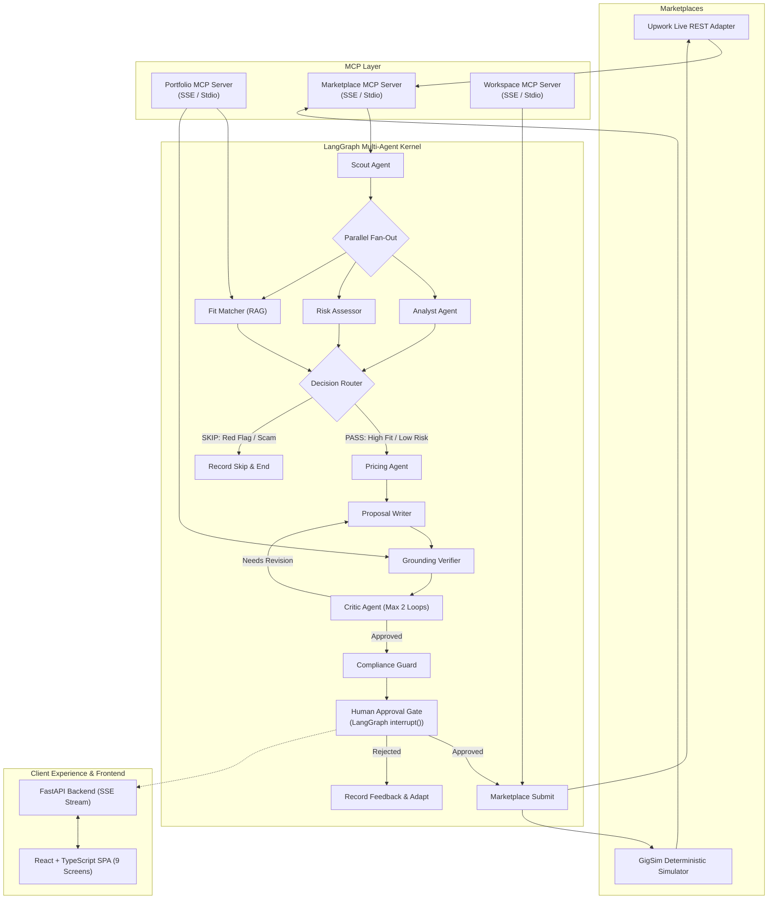

# GigBid Architecture & Technical Design Document

## 1. System Overview
**GigBid** is an autonomous, multi-agent freelancer copilot designed for complex marketplace bidding and client liaison workflows (e.g., Upwork). The system combines:
1. **Model Context Protocol (MCP)** for isolated tool execution across Portfolio, Marketplace, and Workspace domains.
2. **Advanced RAG Retrieval & Claim Verification** (Hybrid BM25 + Dense RRF with atomic claim verification).
3. **Multi-Agent Orchestration via LangGraph StateGraph** featuring parallel fan-out analysis, a bounded Critic reflection loop ($\le 2$), a Compliance Guard, and human-in-the-loop approval gates (`interrupt()`).
4. **Resilient Production Infrastructure** featuring SSE real-time streaming, token and step budget enforcement, and degraded mode failovers.



---

## 2. MCP Server Separation & Discipline

GigBid isolates external interactions through three dedicated Model Context Protocol (MCP) servers:
1. **Portfolio MCP Server (`mcp_servers/portfolio/`)**:
   - `get_profile`: Structured freelancer CV, bio, base rate, and skills.
   - `search_case_studies`: Semantic and keyword retrieval of verified case studies with metrics.
   - `get_repository_evidence`: Read access to sample repositories, architectures, and benchmarks.
   - `get_reviews`: Client testimonials, ratings, and domains.
2. **Marketplace MCP Server (`mcp_servers/marketplace/`)**:
   - `search_jobs`: Query active postings with filters (category, client spend, payment verified).
   - `get_job_details`: Full job description, attachments, and client history.
   - `get_client_reputation`: Payment verification, total spent, hire rate, and avg hourly rate.
   - `submit_proposal`: Write action requiring idempotency key and human approval token.
3. **Workspace MCP Server (`mcp_servers/workspace/`)**:
   - `get_calendar_availability`: Checks freelancer interview slots.
   - `hold_interview_slot`: Temporarily locks interview availability.
   - `draft_email`: Formats client follow-up correspondence.

### Client Discipline & Allowlist Enforcement
The `MultiServerMCPManager` enforces strict, per-agent allowlists. Any attempt by an unauthorized agent to invoke tools outside its boundary immediately triggers a `ClientDisciplineError` and terminates the operation:
- `Scout`: `marketplace.search_jobs`, `marketplace.get_job_details`
- `Fit Matcher`: `portfolio.search_case_studies`, `portfolio.get_repository_evidence`
- `Marketplace Submitter`: `marketplace.submit_proposal` (Gated by Human Approval)

---

## 3. RAG Retrieval & Atomic Grounding Verification

### Hybrid BM25 + Dense RRF (Reciprocal Rank Fusion)
Retrieval merges sparse lexical matches (Okapi BM25) and dense semantic representations (TF-IDF 1024-d n-gram dense embeddings) using Reciprocal Rank Fusion:
$$RRF(d) = \sum_{m \in \{BM25, Dense\}} \frac{1}{60 + \text{rank}_m(d)}$$

### Atomic Claim Grounding Verification (`rag/verify.py`)
To prevent LLM hallucination and fabricated metrics in proposals:
1. **Claim Splitting**: The generated proposal is parsed into atomic claims via regex and syntactic boundaries.
2. **Evidence Matching**: Each claim is evaluated against verified portfolio case studies and repository metrics.
3. **Classification**:
   - `SUPPORTED`: Claim explicitly matches verified case study metrics.
   - `PARTLY_SUPPORTED`: General claim supported in spirit; sanitized with concrete case study citations.
   - `UNSUPPORTED`: Claim asserts metrics or technologies absent from portfolio.
4. **Purge & Rewrite**: Unsupported claims are excised or rewritten into verified assertions.

---

## 4. Multi-Agent Orchestration (LangGraph StateGraph)

### State Schema & Reducers
The `GigBidState` encapsulates the complete lifecycle of a bidding transaction. To prevent update collisions during parallel fan-out execution, state fields employ deterministic reducers:
```python
class GigBidState(TypedDict):
    thread_id: str
    job_id: str
    persona_id: str
    job_spec: Optional[JobSpec]
    risk_report: Optional[RiskReport]
    fit_report: Optional[FitReport]
    bid_decision: Optional[BidDecision]
    price_quote: Optional[PriceQuote]
    proposal_draft: Optional[ProposalDraft]
    claim_evidence: Annotated[List[Dict[str, Any]], reduce_list]
    critique: Optional[Critique]
    critique_rounds: Annotated[int, operator.add]
    compliance_verdict: Optional[ComplianceVerdict]
    human_approval: Optional[ApprovalPayload]
    submission_receipt: Optional[Dict[str, Any]]
    status: Annotated[str, reduce_last]
    step_count: Annotated[int, operator.add]
    total_tokens_used: Annotated[int, operator.add]
```

### Execution Control Loops & Gates
1. **Parallel Fan-out**: `Analyst`, `Risk Assessor`, and `Fit Matcher` execute concurrently after initial scouting.
2. **Router Gate**: If `risk_score > 0.4` (e.g. telegram contact, payment outside Upwork, scam signs) or `fit_score < 0.6`, the graph immediately routes to `record_skip` and terminates, saving LLM tokens and connects.
3. **Critic Reflection Loop**: Bounded to at most 2 iterations. If the proposal fails readability or persuasion standards, it returns to the `Writer` with explicit revision instructions.
4. **Compliance Guard**: Performs deterministic regex and rule checks for platform policy violations (contact info leaks, off-platform payments, unrealistic guarantees).
5. **Human Approval Gate (`interrupt()`)**: Halts execution state and surfaces the complete proposal, pricing breakdown, and evidence hover card to the Proposal Studio UI. External write operations (`submit_proposal`) cannot be executed without resume payload.

---

## 5. Persistence, Crash Recovery & Budgets

- **Crash Recovery**: Checkpointing is powered by `MemorySaver` / SQLite checkpointer. If the backend restarts while runs are in progress, threads resume from the exact node state without re-evaluating completed nodes.
- **Rate Limit & Connects Budget**: Daily connects budget (`max_daily_bids`) is enforced in `worker/scheduler.py` and `gigsim/server.py`.
- **Degraded Mode Failover**: When MCP servers experience timeout or failure, the agent transitions to degraded mode, utilizing cached local persona profiles and notifying the UI via `DegradedBanner.tsx`.
