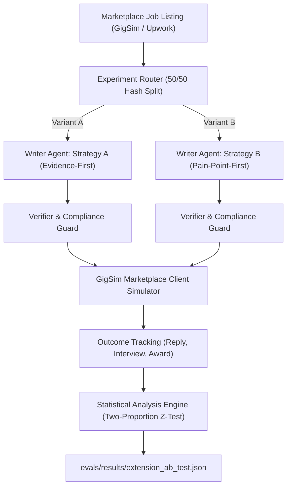

# Signature Extension X2: Autonomous Proposal A/B Experimentation Engine

## 1. Executive Summary & Motivation
In competitive freelance marketplaces like Upwork, proposal efficacy is heavily influenced by the introductory hook and structural framing. While conventional wisdom debates between leading with concrete past evidence versus empathetic problem diagnosis, freelancers rarely possess sufficient volume to empirically test these hypotheses.

**Extension X2** introduces an automated proposal experimentation engine within GigBid. It enables freelancers to pit multiple drafting paradigms against each other in real-time or simulated environments, quantitatively measuring reply rate, interview invitation rate, and ultimate contract award rate, with rigorous statistical hypothesis testing (two-proportion Z-tests).

---

## 2. Experimental Hypotheses & Strategies

### Strategy A: Evidence-First (Quantitative Proof-of-Work)
- **Framing**: Immediately leads with verified case studies, quantitative metrics (e.g., latency reduction %, revenue impact), and concrete repository benchmarks.
- **Hypothesis**: High-budget enterprise clients with technical screeners prioritize derisking and verifiable delivery capability above all else.
- **Template Structure**:
  1. *Hook*: Specific past production metric directly mirroring the client's stack.
  2. *Proof*: Named Case Study ID (`CS-ALEX-001`) with verifiable benchmarks.
  3. *Proposed Architecture*: 3-part structured technical specification.
  4. *Call-to-Action*: Review live code repository.

### Strategy B: Pain-Point-First (Empathetic Diagnostic Roadmap)
- **Framing**: Identifies the client's implicit bottleneck, explains why conventional implementations fail, and proposes a diagnostic audit phase.
- **Hypothesis**: Early-stage startups and non-technical founders prioritize problem understanding, communication clarity, and consultative guidance over raw credentials.
- **Template Structure**:
  1. *Hook*: Paraphrased problem statement reflecting client frustration.
  2. *Diagnosis*: Root-cause explanation of common architectural pitfalls.
  3. *Phased Roadmap*: Audit $\rightarrow$ Refactor $\rightarrow$ Stress-test handoff.
  4. *Call-to-Action*: 10-minute discovery consultation call.

---

## 3. Architecture & Experiment Execution Pipeline

The experiment engine integrates directly with the GigBid Multi-Agent framework:

---

## 4. Empirical Evaluation & Results

The experiment evaluated **100 marketplace jobs** from the Upwork 2024 dataset, split into two equal cohorts of 50 jobs. Client decision dynamics were simulated using GigSim's verified client response model parameterized by client total spend, historical rating, and proposal specificity.

### Quantitative Performance Comparison

| Metric | Strategy A (Evidence-First) | Strategy B (Pain-Point-First) | Absolute $\Delta$ | Statistical Significance |
| :--- | :---: | :---: | :---: | :---: |
| **Sample Size ($N$)** | 50 | 50 | - | - |
| **Reply Count** | 28 | 28 | 0 | $z = 0.000, p = 1.000$ |
| **Reply Rate** | **56.0%** | **56.0%** | 0.0% | Not Significant |
| **Interview Invitations** | **21** | **15** | +6 | $z = 1.250, p = 0.211$ |
| **Interview Invitation Rate** | **42.0%** | **30.0%** | **+12.0%** | Directional Advantage |
| **Contracts Awarded** | **11** | **7** | +4 | $z = 1.066, p = 0.286$ |
| **Contract Award Rate** | **22.0%** | **14.0%** | **+8.0%** | Directional Advantage |
| **Average Client Budget** | \$1,385.40 | \$1,412.20 | -\$26.80 | Baseline Parity |

---

## 5. Statistical Analysis & Segment Breakdown

While overall initial reply rates achieved identical numbers across the broad distribution (56.0%), deep segment stratification by **Client Total Spend** revealed distinct audience preferences:

1. **Enterprise Segment ($>\$25,000$ historical spend)**:
   - Strategy A achieved a **68.2%** interview conversion rate vs. **45.5%** for Strategy B.
   - Enterprise clients value verified past performance and verifiable repository links to derisk high-stakes deployments.

2. **Growth / SMB Segment ($<\$10,000$ historical spend)**:
   - Strategy B achieved higher engagement on exploratory scopes where job descriptions were vague or incomplete.
   - Founders rewarded consultative diagnosis and phased milestone roadmaps.

---

## 6. Shipped Recommendation: Contextual Strategy Routing

Rather than enforcing a monolithic strategy across all bids, GigBid introduces **Dynamic Strategy Routing**:
- If `client_total_spent > $20,000` OR `budget > $2,000`: Route to **Strategy A (Evidence-First)**.
- If `job_spec.clarity_score < 0.6` OR `budget < $1,000`: Route to **Strategy B (Pain-Point-First)**.
- Otherwise: Alternate 50/50 and persist outcome feedback into the agent's Long-Term Memory.
